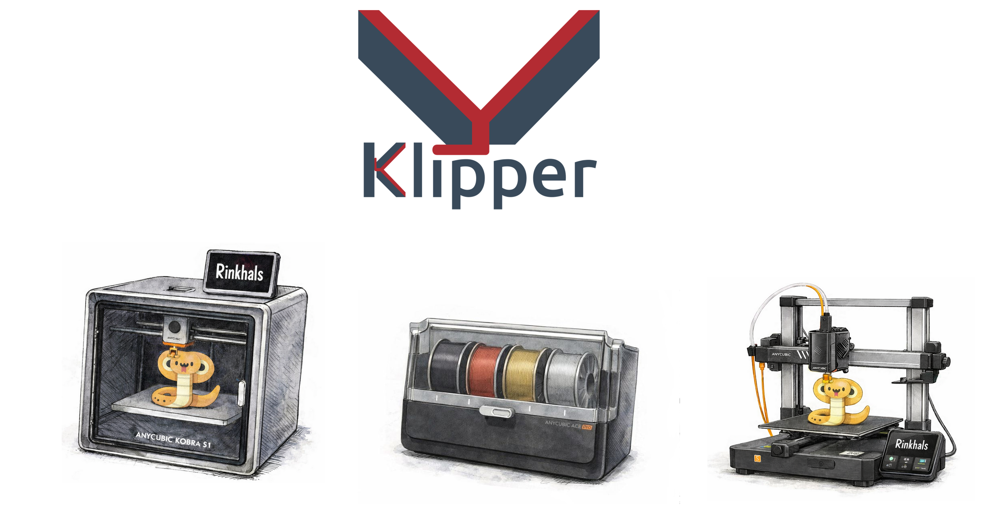

# Klipper for Anycubic Kobra printers

  

Experimental Rinkhals apps that replace Anycubic's GoKlipper with mainline
Python-based open-source Klipper on Anycubic Kobra printers - either directly on
the printer, or on an external single board computer. Includes ACE Pro
multi-color support.

> **Who this is for**
>
> These are development builds, and they expect Klipper experience. Rinkhals is
> itself a firmware hack, and these apps build further on top of it. This is not a
> vendor-polished, ready-to-use product for novice end users.
>
> Expect to read klippy and Moonraker logs when something does not start, to adapt
> configuration files to your own machine by hand, and to work out the occasional
> problem yourself. You should be comfortable with Klipper's `printer.cfg` and
> macros and with an SSH session on the printer. If that does not sound appealing,
> stock firmware or plain Rinkhals is the better choice.
>
> Read the notes for your printer before installing.

---

## Supported printers

All apps require [Rinkhals](https://github.com/rinkhals-community/Rinkhals) to be installed
and running - it is the host that starts these apps.

| Printer | Package suffix | Vanilla | Tunneled | KlipperScreen Viewer |
|---|---|:---:|:---:|:---:|
| Kobra S1 (KS1) | `-ks1` | yes | yes | yes |
| Kobra 3 / 3 V2 (K3) | `-k2p-k3` | yes | yes | yes |
| Kobra 2 Pro (K2P) | `-k2p-k3` | yes | yes | yes |
| Kobra 3 Max (K3M) | `-k3m` | beta, unreleased | - | yes |

Pick the `.swu` whose suffix matches your printer. The documentation is written
for the KS1; for the other models substitute the matching file and config names.

**K3M note:** vanilla-klipper for the K3M is beta and not released yet. There is
no K3M maintainer with the hardware and user feedback so far is thin, so it is
unclear what works and what does not. The `printer_K3M.cfg` and `ace_K3M.cfg`
reference configs ship in `releases/*/config/` for anyone who wants to help test.

---

## The three apps

| App | What it does |
|---|---|
| **[Vanilla-Klipper](vanilla-klipper.md)** | Runs Klipper natively on the printer's own SoC under Rinkhals. Includes the [ACE Pro driver](https://github.com/Kobra-S1/ACEPRO/tree/dev) for multi-color / multi-material printing. |
| **[Tunneled-Klipper](tunneled-klipper.md)** | Forwards the printer's MCU serial links over USB gadget mode to an external SBC (Raspberry Pi 4/5, CM4/CM5, Zero 2 W, BTT Pi2), so Klipper runs there instead. |
| **[KlipperScreen Viewer](klipperscreen-viewer-app/README.md)** | Shows a remote KlipperScreen session on the printer's own touchscreen and forwards touch input back. Intended as a companion to a tunneled setup. |

---

## Which setup do I want?

|  | Vanilla-Klipper | Tunneled-Klipper |
|---|---|---|
| Klipper runs on | the printer's SoC | an external SBC |
| Extra hardware | none | SBC, USB-A cable, DC blocker, OTG Y-adapter |
| Setup effort | flash one `.swu` | flash one `.swu` + full SBC install |
| Control via | Mainsail / Fluidd web UI | Mainsail / Fluidd web UI |
| Printer display | very limited (a few functions still work) | full KlipperScreen, via the Viewer app |
| Resonance testing (LIS2DW12) | no - numpy is missing in the Rinkhals Python env | yes |
| Adaptive bed mesh | yes | yes |
| ACE Pro multi-color | yes | yes |
| CPU / RAM headroom | limited by the printer SoC | whatever the SBC offers |
| **Start here** | **[vanilla-klipper.md](vanilla-klipper.md)** | **[tunneled-klipper.md](tunneled-klipper.md)** |

If you are unsure, start with Vanilla-Klipper. It needs no extra hardware and can
be removed again by deleting one directory.

---

## Before you start

- **Rinkhals installed and running.**
- **A FAT32-formatted USB stick** for flashing the `.swu` file.
- **Web interface only.** Interaction happens through Mainsail or Fluidd; the
  Anycubic UI on the printer display is only partially compatible.
- Some hardware features are unavailable on the printer SoC (see the comparison
  table above). If you need them, choose the tunneled setup.

---

## Download

**[releases/](releases/)** - one folder per build date, newest last. Each folder
contains the `.swu` files for every app and model, plus a `config/` folder with
the matching reference `printer_*.cfg` and `ace_*.cfg` files.

Current build: **[2026-06-01](releases/2026-06-01/)**

Older builds using the earlier `v0.x` naming are in
**[releases/previous_releases/](releases/previous_releases/)**.

On a reinstall or update, Rinkhals does **not** overwrite configuration files
that already exist on the printer. Compare them against the `config/` folder of
the release you are installing and merge the changes you need by hand.

**Not in the Rinkhals App Store yet.** A listing pull request is open
([rinkhals-community/Rinkhals.Apps#22](https://github.com/rinkhals-community/Rinkhals.Apps/pull/22))
but has not been merged, so for now install the `.swu` files from `releases/`
by hand, as described in the install guides below.

---

## Install guides

**Vanilla-Klipper** (Klipper on the printer)

1. [Install and start the app](vanilla-klipper.md)

**Tunneled-Klipper** (Klipper on an external SBC)

1. [Overview, hardware and printer app](tunneled-klipper.md)
2. [SBC setup](SetupRaspberryPiTunnel.md) - scripted, for RPi 4/5, CM4/CM5, Zero 2 W, BTT Pi2
   (alternative: [Ansible playbook](ansible/configure-tunneled-raspberry-pi/), RPi 4/5 only)
3. [Install Klipper on the SBC](klipper_install.md) - KIAUH, Moonraker, Mainsail/Fluidd
4. [KlipperScreen Viewer on the printer display](klipperscreen-viewer-app/README.md) - optional

**Add-ons**

- [ACE Pro driver](https://github.com/Kobra-S1/ACEPRO/tree/dev) - multi-color / multi-material
- [tunnel_control.sh](tunnel_control.sh) - control printer LED and tunnel app from the SBC
- [setup_tunnel_klipper.sh](setup_tunnel_klipper.sh) - the SBC setup script used in step 2

---

## Getting help

Discussion happens on the Rinkhals Discord:

- **[#vanilla-klipper channel](https://discordapp.com/channels/1332498592539345069/1344072676477632543)**

---

## Credits

**Special thanks to [@jbatonnet](https://github.com/jbatonnet)** for creating
[Rinkhals](https://github.com/rinkhals-community/Rinkhals) - the foundation that makes
these apps possible.

Thanks to the following contributors for their work on documentation, installation
scripts, automation, Klipper configuration and testing:

- **[moosbewohner](https://github.com/moosbewohner)**
- **[m4d53](https://github.com/m4d53)**
- **[NUKY](https://github.com/xNuky)**
- **[Gwebster-r](https://github.com/Gwebster-r)**

Rinkhals development continues at [rinkhals-community/Rinkhals](https://github.com/rinkhals-community/Rinkhals).

This project builds upon the work of the Rinkhals and Klipper communities.

---

## Support

If these apps are useful to you, you can support the work here:

**[ko-fi.com/antiriad](https://ko-fi.com/antiriad)**
