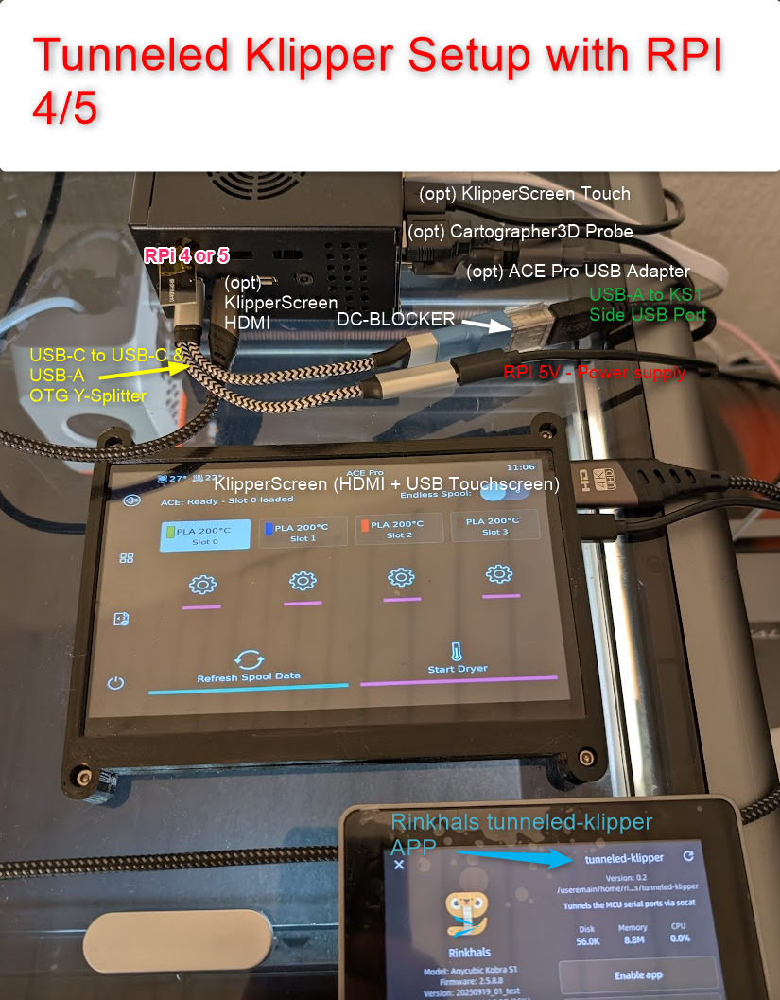
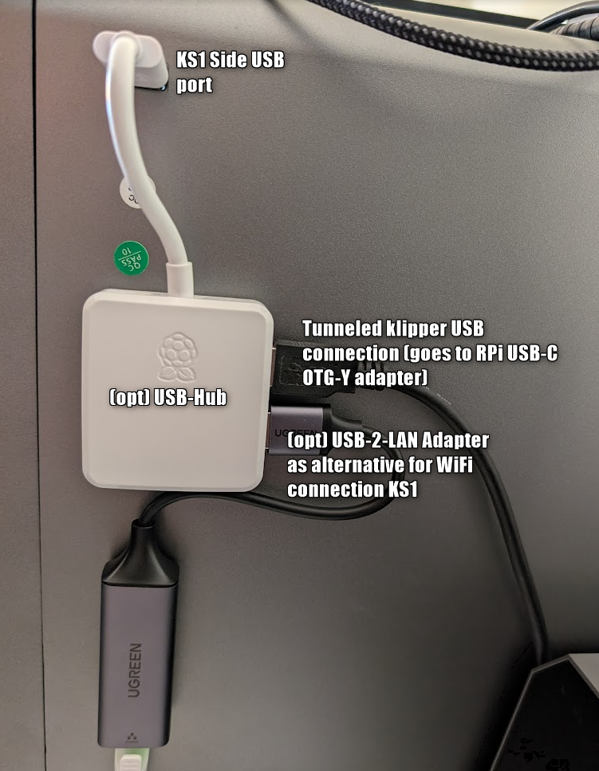
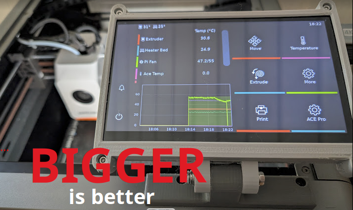
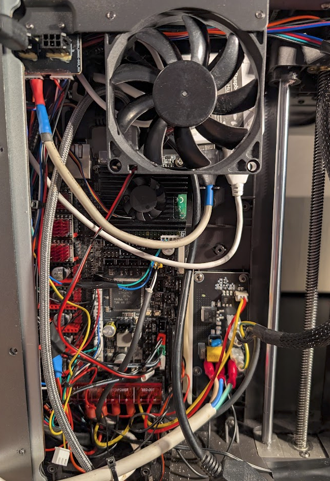

# Tunneled-Klipper App for Rinkhals on supported Anycubic Kobra printers

> **Tunneled-Klipper setup:** **1. Overview and printer app** &rarr; [2. SBC setup](SetupRaspberryPiTunnel.md) &rarr; [3. Klipper on the SBC](klipper_install.md) &rarr; [4. Printer display](klipperscreen-viewer-app/README.md) (optional) &middot; [Repository overview](README.md)

The **tunneled-klipper** app forwards the printer's MCUs serial interface connections to an SBC which supports OTG USB serial gadget mode (for example Raspberry Pi 4/5, Compute Module 4/5, Zero 2 W, or BTT Pi2).
This lets you run Klipper on the external SBC while the tunneled-klipper APP (running on the Kobra printers SoC, hosted by Rinkhals) acts as a serial bridge to the MCUs.

Overview of the general setup:

<p align="center">
  
</p>

Additional Required Hardware:
- Raspberry Pi 4/5, Compute Module 4/5, Zero 2 W, BTT Pi2, or any other SBC with serial gadget OTG support
(⚠️ **Raspberry Pi Zero 2 W note:** Zero 2 W support is included only because it is capable of OTG serial gadget mode. It is **not recommended** to run Klipper on Zero 2 W for regular use because CPU and RAM resources are very limited.)

- USB-A to USB-A cable to connect the SBC with Kobra printer via OTG adapter
- USB-A DC-DC Blocker to prevent backpowering of the printer via the USB-A connection by the SBC
- OTG USB-C to USB-C+USB-A "Y" Adapter (buy a quality one which is capable of providing enough current for your SBC; simple ones often limit to max 3A). Alternative: Power the SBC via 5V GPIO pin, connect USB-C port via USB cable directly (via the DC-DC blocker to avoid back-powering) to the printer.

- Optional, for ACE Pro: one adapter from the ACE Pro 4-pin connector to the SBC. Which
  cable you need depends on the ACE generation - see below.

**ACE Pro adapter**

| ACE unit | 4-pin connector carries | What you need |
|---|---|---|
| **ACE Pro (Gen 1)** | USB data | A 4-pin to USB-A cable. You have to build your own - see the [ACE Pro driver repo](https://github.com/Kobra-S1/ACEPRO/tree/dev) |
| **ACE 2 Pro** | RS-485 | The **KS1/K3 cable that comes with the ACE Pro 2 kit** - the same cable as for Gen 1, but with an RS-485-to-USB converter built in - plus the same self-built 4-pin to USB-A adapter on its printer-side end |

> **A Kobra-X or KS1-MAX ACE2 cable will not work.** That one is plain wiring which
> just carries the RS-485 signals through, and the 4-pin to USB-A adapter is plain
> wiring as well. With no RS-485-to-USB converter anywhere in the chain, an ACE 2 Pro
> speaking RS-485 cannot talk to a USB port on the SBC.

One adapter is enough even for several units: the ACE Pros are daisy-chained, so only
the first one in the chain connects to the SBC. Chain limit: up to 3 ACE Pro (Gen 1)
units, due to the ACE Pro internal USB hub, plus up to 4 ACE 2 Pro units behind the
last Gen 1 unit - 7 in total.

---

## 🛠️ Requirements

- SBC with OTG Serial Gadgetmode support. Script-based setup is tested on Raspberry Pi 4/5, Compute Module 4/5, Zero 2 W, and BTT Pi2 (CB2/Armbian).
- USB-C to USB-A OTG cable with an additional USB power blocker  
- USB serial-gadget setup and a Klipper installation on the SBC - covered by steps 2 and 3 of this guide
- Installation of klipper ACEPro driver (with optional Klipperscreen support) if you want to use the ACE-Pro (https://github.com/Kobra-S1/ACEPRO/tree/dev)
- Installation of klipperscreen-viewer app if you want to use the printer screen itself as KlipperScreen ([klipperscreen-viewer-app/README.md](klipperscreen-viewer-app/README.md))


Example setup for Kobra-S1:



 
---

## 🔄 Use Case

Choose tunneled-klipper if:

- You prefer running Klipper on an external SBC (to avoid the CPU/memory limitations of the Kobra SoC).  
- You want features not supported by the SoC build (e.g., LIS2DW12 resonance testing).

Otherwise, using [vanilla-klipper](vanilla-klipper.md) directly on the SoC is an easier to install option.

---

## 🔌 Connection options

Forwarding the MCU serial links over USB OTG is what this guide covers, and it is
by far the simplest route: nothing is taken apart, no cables are cut, you plug in
a USB cable. The alternatives below put fewer hops between the MCUs and the SBC,
which can mean a more robust link, but they involve rewiring or replacing printer
hardware and are only for people comfortable with that.

| Option | What it takes | Effort and risk | Covered here |
|---|---|---|---|
| **USB OTG serial gadget, external SBC** | Plug a USB cable between printer and SBC | Low - no disassembly, fully reversible | Yes, this guide |
| **USB OTG serial gadget, SBC mounted inside the printer** | Same software setup, SBC housed in the printer and powered from it | Low to medium - case work and power wiring | Software side, yes |
| **[LAN tunnel](https://github.com/moosbewohner/Kobra-S1-Lan-Tunnel) to an external SBC** | Forward the MCU serial links over TCP instead of USB, using a separate Rinkhals app | Medium | Separate project |
| **Direct UART wiring to the SBC GPIO header** | Move the MCU RX/TX pairs off the SoC board onto two SBC UARTs | High - rewiring, and the SoC software has to be neutered | No, notes below |
| **Full board swap** | Replace the MCU driver board and the SoC board with a Klipper board, keep only the toolhead MCU board, plus a display solution | Highest | No |

> **The LAN tunnel is an alternative to the tunneled-klipper app, not an addition.**
> [Kobra-S1-Lan-Tunnel](https://github.com/moosbewohner/Kobra-S1-Lan-Tunnel) ships its own `.swu` for KS1, K2P/K3 and K3M, and
> bridges the MCU serial links over TCP (printer ports 7003 and 7005) to
> `/dev/ttyMCU1` and `/dev/ttyMCU2` on the SBC using `socat`. Enable **only one**
> of the two apps: both claim the same MCU serial links, so running them together
> will not work. That project is still under active development.

### Direct UART wiring


- Two RX/TX/GND pairs run to the upper SoC board, one from the lower MCU board and
  one from the toolhead MCU board. Route both to two UARTs on the SBC GPIO header.
- Disconnect only the **RX/TX lines** from the SoC board, not the whole connectors -
  they also carry the supply voltages.
- Enable at least two GPIO-header UARTs on the SBC via device tree overlay.
- In `printer.cfg`, change the serial names in `[mcu]` and `[nozzle_mcu]` from
  `/dev/ttyGS0` / `/dev/ttyGS1` to the SBC's native UART device names.
- GoKlipper can no longer reach the MCUs and will fail to start with an MCU error,
  so the SoC board software must be patched to stop the Anycubic processes from
  starting at all. One option is a stripped-down Rinkhals build that provides only
  the KlipperScreen Python environment and networking, with Moonraker, Mainsail,
  the streamer and the web UI disabled. Another is replacing the OS entirely with
  something that runs on the RV1106G3 (a Luckfox image, Alpine).
- For a full board swap only the toolhead MCU needs this treatment - the lower
  board MCU is replaced by the Klipper board's own MCU.

### Full board swap

The MCU driver board and the SoC board are replaced by a single Klipper board -
here a BTT Manta M8P in the KS1 rear compartment. Only the toolhead MCU board
stays as it is.

That leaves the printer without a working display. Two ways around it:

- Add an external touch LCD and run KlipperScreen on it. A larger HDMI panel can be
  mounted in the original screen's place:

  <p align="center">
    
  </p>

- Keep the SoC board in place purely as a display driver, reusing the original
  LCD, and run the [KlipperScreen Viewer](klipperscreen-viewer-app/README.md) app
  on it. With no MCU connections left, GoKlipper will not start properly, so the
  SoC software has to be modified to keep it out of the way - the same problem as
  with direct UART wiring above. Not trivial, and not covered here.

The Klipper board leaves no room for the original power supply, so the PSU has to
be relocated outside the printer.

<p align="center">
  
</p>

> **This route involves mains wiring.** Relocating the power supply means cutting,
> extending and re-terminating mains-voltage cable, and building a new enclosure
> and strain relief for it. Unlike a bricked SoC board, a mistake here is an
> electrocution and fire risk. If you are not qualified and equipped to work on
> mains safely, do not take this route.

---

## 📋 Preconditions

- A [supported Anycubic Kobra printer](README.md#supported-printers) with **Rinkhals** already installed and running. This how-to uses the KS1 file names throughout; for any other model, substitute the matching package suffix and config names.
- Update file from **[Releases folder](releases/)**. Current release:
  ```
  app-tunneled-klipper-ks1.swu
  ```

---

## 🚀 Installation Steps

1. **Prepare the update file**
   ```bash
   app-tunneled-klipper-ks1.swu → update.swu
   ```
   Create a folder named 'aGVscF9zb3Nf' in the root of your FAT32 formated USB drive, then copy the SWU file into it:
   ```
   aGVscF9zb3Nf/update.swu
   ```

2. **Insert the USB drive into the printer**
   - 1st beep → Printer has recognized that there is SWU file and starts checking if it has the right format
   - 2nd beep → SWU file was accepted and the Rinkhals APP installer has finished its job

3. **Open the Rinkhals App Menu**
   ```
   Settings → Rinkhals → Manage apps
   ```
   You should now see **tunneled-klipper** listed.

---

## ⚙️ Starting Tunneled-Klipper

### Start/stop the app manually

- Open the **tunneled-klipper** entry by tapping its name.  
- Press **Start App** to start it only for this power-cycle, or press **Enable App** to enable automatic startup.
  A double-beep confirms the app has started; another two beeps also occur if the external SBC is already connected and serial ports are detected.
- Use the same button to stop/restart GoKlipper as needed.

### SBC setup (RPi4/RPi5/CM4/CM5/RPi Zero 2 W/BTT Pi2)

- Install Klipper on your SBC as usual, by using this forked Klipper branch: https://github.com/Kobra-S1/klipper-kobra-s1/tree/Kobra-S1-Dev  
  **IMPORTANT:** Check out the "dev" branch, don't use 'main' (which is just the currently used base for the Kobra-S1 patches)

- Create your Klipper `printer.cfg` on your SBC:
  - Start from your existing config; comment out unsupported keys.  
  - Change `/dev/ttyS3` and `/dev/ttyS5` to the serial-gadget devices (likely `/dev/ttyGS0` and `/dev/ttyGS1`).  
  - Or use the ready-to-use KS1 named config files from the latest release 'config' folder: **[releases](releases)**  
    (You need all files with 'generic' in their name, plus the ones named for your printer model)

- Open Mainsail in your browser.  
- Click **MCU Restart** if the connection isn’t established automatically at startup.

**Webcam from KS1 in Mainsail**

In Mainsail, click the gear icon (top-right) → scroll to **Webcams** → **ADD WEBCAM**. Add two streams, replacing `YourPrinterName` with the hostname or IP of your KS1:

- Stream URL: `http://<YourPrinterName>:8080/?action=stream`  
- Snapshot URL: `http://<YourPrinterName>:8080/?action=snapshot`

---

## ⚠️ Functional Notes
- To avoid spurious issues with klippy connecting to the S1 MCUs after reboot, add these two lines into your `/etc/systemd/system/klipper.service` file (above `ExecStart=/home/pi/klippy-env/bin/python $KLIPPER_ARGS`):
```
 ExecStartPre=/bin/stty -F /dev/ttyGS0 sane
 ExecStartPre=/bin/stty -F /dev/ttyGS1 sane
```
Afterwards execute:
```
 sudo systemctl daemon-reload
 sudo systemctl restart klipper
```
- To allow full MCU reconfiguration via the tunneled vanilla-Klipper, MCUs are reset at every start/stop. This causes the LED light to flicker. (Without this, changes—e.g., nozzle sensitivity—wouldn’t be possible.)

- When the app starts, it waits for two serial-gadget interfaces to appear and then uses the Linux-assigned serial-port names for the `socat` tunnels. This name detection avoids collisions with ACE-PRO-assigned `/dev/ttyACMx` names.

- SBC detection for setup is available in `setup_tunnel_klipper.sh` via auto-detect or manual selection (RPi4, RPi5, CM4, CM5, RPi Zero 2 W, BTT Pi2). Runtime tunnel detection on the printer side still expects compatible USB gadget serial devices.

- The SBC can already be connected when you start the app, but you can also start it first and connect later.  
  Disconnecting/reconnecting USB while the tunneled app is running is supported. If a `socat` connection breaks due to USB interruption, the MCUs are reset; use **FIRMWARE RESTART** in Mainsail to re-establish the connection.

- Sometimes the MCU connection after first boot cannot be properly established and even FIRMWARE RESTART alone does not fix it. In this case a hard MCU reset is necessary. The quickest way to do that is to remove the USB plug from the printer, wait until you hear two USB disconnect beeper-jingles after 1-2 seconds, then replug, wait for two more confirmation jingles and then try FIRMWARE RESTART again.

---

## 🔊 Sound Indications

- At app startup, a short **double beep** indicates the delayed app launcher has begun (the “real” app starts ~15s later to avoid boot-time CPU issues).  
- Then you’ll hear the **normal double beep** from GoKlipper.  
- A **three-tone beep** indicates the “real” tunneled-Klipper app has started.  
- If an SBC is already connected at startup, you’ll immediately hear **two short double beeps**, each indicating a serial-gadget was detected and a `socat` tunnel launched.  
- If USB is **disconnected** while printing, the MCUs reset and a **two-tone beep** plays when the `socat` tunnels are removed.  
- If USB is **reconnected**, another **two-tone beep** indicates the `socat` tunnels have restarted.
